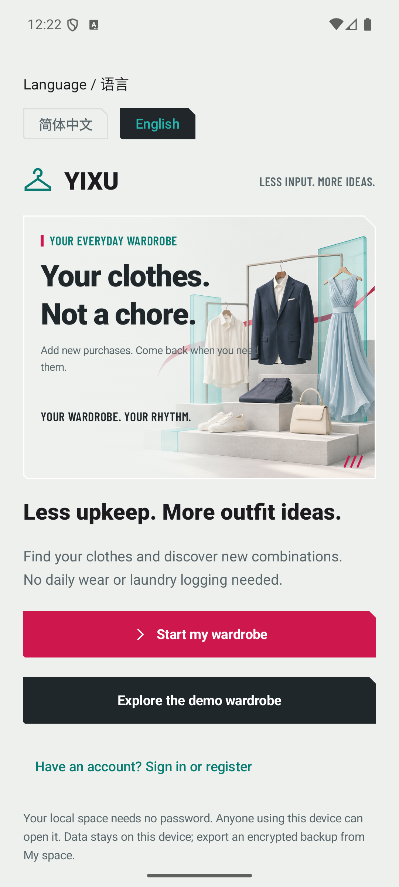
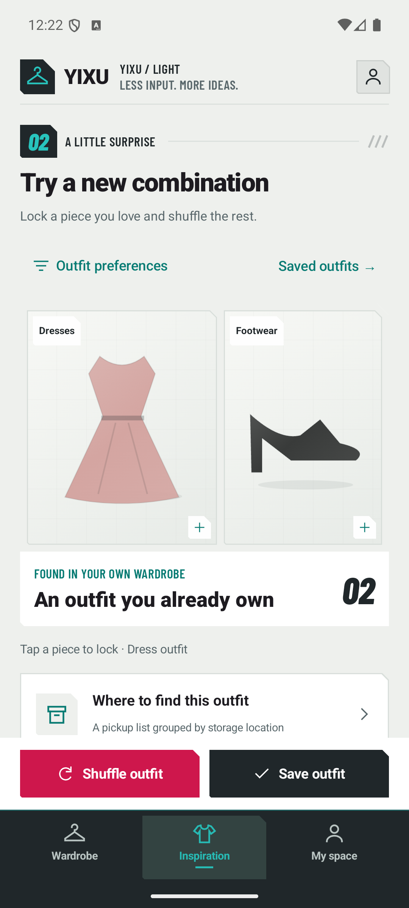
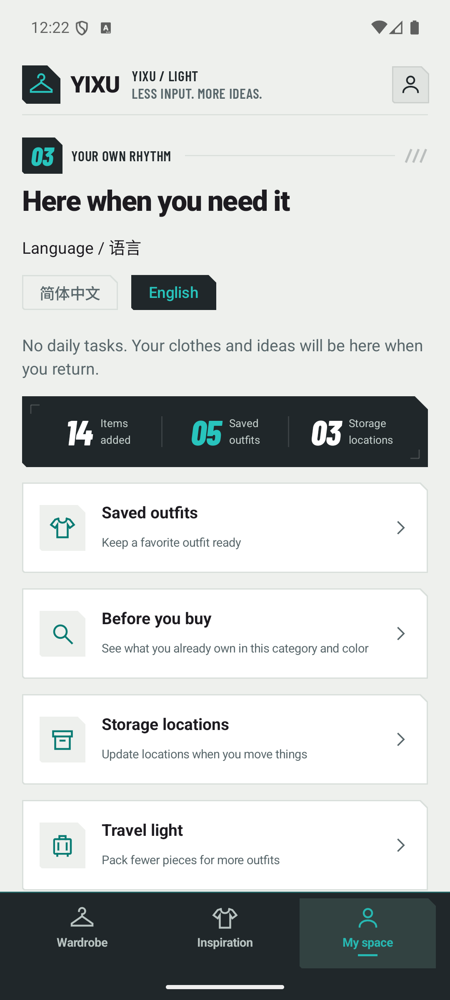
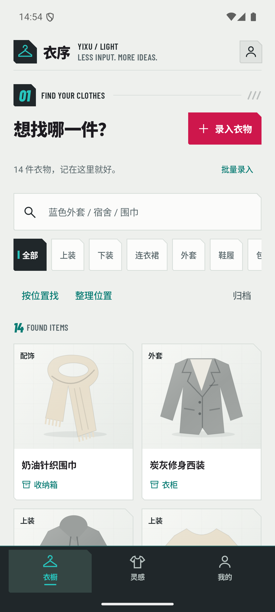
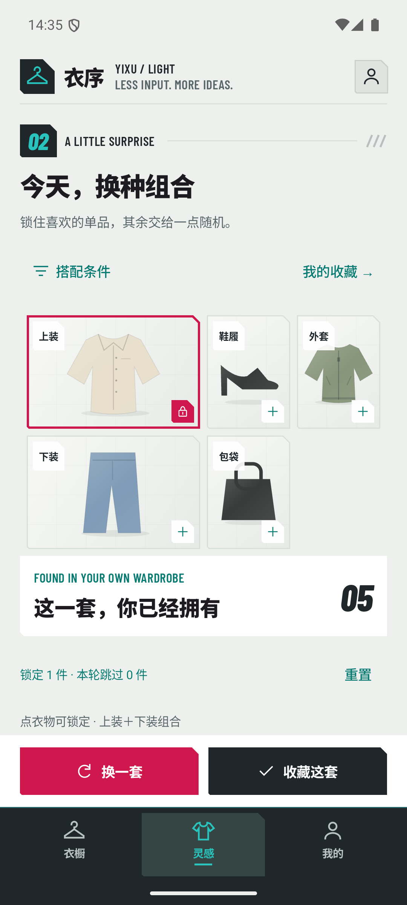
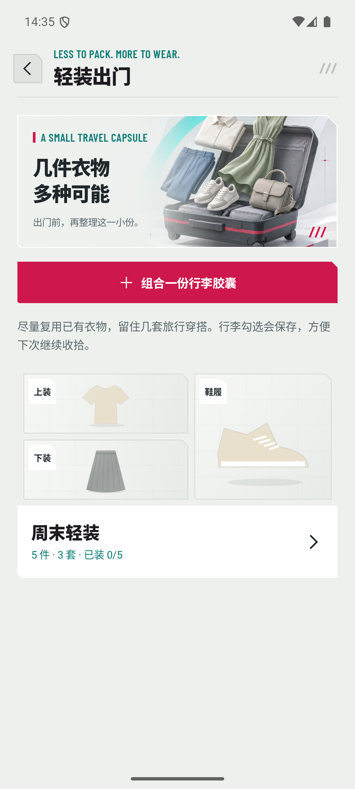
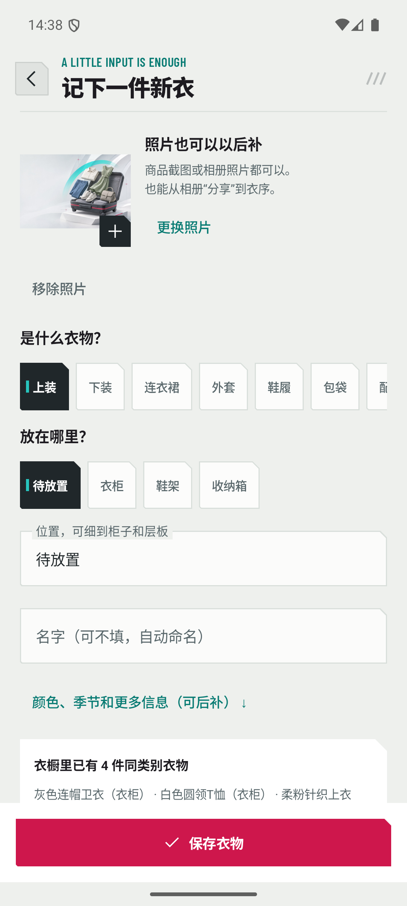
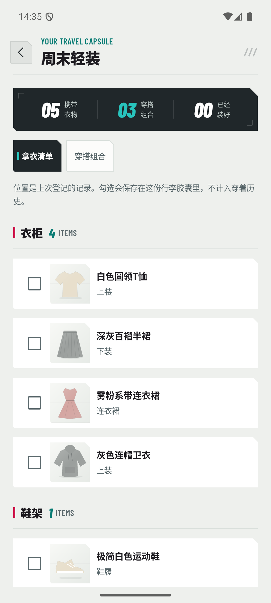
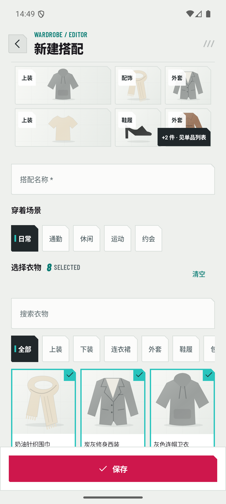

# 衣序轻量版 · YIXU Light

**买新衣时记一下，需要时找得到、搭得起来。**

衣序是一款使用 **Kotlin + Jetpack Compose** 开发的本机离线 Android 衣橱应用。围绕快速录入、按位置找衣、可控随机搭配和旅行装箱设计，不要求每天登记穿着或洗衣服。

当前版本：`2.0.0-alpha3` · 本机离线 · 支持男装、女装与中性款式

[下载 Android 安装包](apk/Yixu-Light-2.0.0-alpha3-debug.apk?raw=true) · [查看操作录像](docs/screenshots-light/final/motion-light.mp4) · [验证记录](docs/轻量版验证记录.md)

## 中文 / English

从欢迎页，或进入 **我的 → 语言 / Language**，选择 **简体中文** 或 **English**。切换立即生效，下次打开应用会保留选择。衣物名称、收纳位置、备注及已有示例数据保留原文，不会被改写。

Choose **简体中文** or **English** on the welcome screen or in **My space → Language**. Your selection is saved on this device. User-entered names, locations and notes stay unchanged. English color and category keywords can also find existing items.

<table>
<tr><th>Language selection</th><th>Outfit inspiration</th><th>My space</th></tr>
<tr>
<td></td>
<td></td>
<td></td>
</tr>
</table>

语言版验证与实现说明见 [中英文切换验证记录](docs/中英文切换验证记录.md)。

## 界面预览

以下为应用在 Android 16 模拟器中的实际运行截图，使用内置示例衣橱数据。

<table>
  <tr>
    <th>我的衣橱</th>
    <th>锁定单品，换出新搭配</th>
    <th>轻装出门</th>
  </tr>
  <tr>
    <td></td>
    <td></td>
    <td></td>
  </tr>
</table>

<details>
<summary>更多界面：衣物照片、装箱清单与手动搭配</summary>

<table>
  <tr>
    <th>完整展示衣物照片</th>
    <th>按位置整理装箱清单</th>
    <th>手动组合搭配</th>
  </tr>
  <tr>
    <td></td>
    <td></td>
    <td></td>
  </tr>
</table>

</details>

## 软件架构

本项目采用 **MVVM + 分层架构（Repository 接口与业务用例）**。Compose UI 接收操作，`WardrobeViewModel` 协调任务并发布 `StateFlow<AppState>`；领域层定义模型、规则与接口，数据层通过 `LocalWardrobeRepository` 接入现有 SQLite 数据源。语言设置也通过独立接口隔离本地存储。

[完整架构说明、依赖图和保存流程](docs/软件架构说明.md) · [架构重构验证记录](docs/架构重构验证记录.md)

```text
ui → presentation → domain（接口与用例）
                         ↑
                    data（接口实现）
MainActivity：组装并注入实现
```

运行 `python3 scripts/check-architecture.py` 检查包依赖边界；构建脚本会自动执行。架构说明中还包含可用于课程展示的中英文讲解。

## 可以做什么

| 使用场景 | 功能 |
| --- | --- |
| 买了一件新衣服 | 选类别、记位置即可保存，名称可以自动补全；照片、颜色、季节、品牌等可后补 |
| 第一次整理衣橱 | 批量选择最多 20 张照片，统一设置位置与类别，也能逐件修改，整批保存 |
| 相册里已有商品截图 | 从系统分享菜单将图片发送到衣序，确认当前空间后进入新衣物草稿 |
| 想不起衣服放在哪里 | 搜索名称、颜色、类别、品牌、备注或登记位置，也可以按位置浏览 |
| 换季整理、换柜子 | 多选衣物，批量更新收纳位置 |
| 不知道今天穿什么 | 生成一套搭配，锁定喜欢的单品，换一件或换整套；支持暂时排除与收藏 |
| 今天特别想穿某件衣服 | 在衣物详情选择“今天就想穿这件”，围绕它生成搭配 |
| 准备买类似的衣服 | “买前看一眼”按类别和颜色展示已有衣物，帮助对照 |
| 准备旅行 | 尽量复用单品生成多套穿搭，保存旅行胶囊，按登记位置查看并勾选装箱清单 |
| 已经有自己的搭配想法 | 手动选择衣物、保存搭配，之后查看完整单品与拿衣清单 |

位置表示**上次登记的位置**，需要用户在搬动衣物后更新。软件不会自动知道衣物的实时位置或洗护状态。

搭配与旅行胶囊使用可解释的本地规则和随机探索。基本组合为“上衣＋下装”或“连衣裙”，可加入鞋、外套和包；旅行套数按不同上衣／下装或连衣裙计算，不靠换鞋增加套数。算法尽量复用单品，但不保证全局最少件数。目前没有自动识别衣物、智能抠图或虚拟试衣功能。

### 可选记录，不增加日常负担

日历、穿着记录、洗护记录和统计保留在“我的 → 可选工具”，不影响默认推荐，也不要求每日维护。

- 保存或调整计划、生成或收藏搭配、更新位置、勾选行李，都不会自动生成实际穿着记录。
- 历史不会自动过期，归档衣物仍保留既有记录。
- 统计描述用户主动登记的数据，“没有记录”不等于“没有穿过”。

## 安装体验

1. 在 Android 手机上下载 [Yixu-Light-2.0.0-alpha3-debug.apk](apk/Yixu-Light-2.0.0-alpha3-debug.apk?raw=true)。
2. 根据系统提示允许本次安装，安装后打开“衣序轻量版”。
3. 选择“直接开始我的衣橱”即可使用；也可选择“先逛逛示例衣橱”体验独立的演示空间。
4. 如需密码保护，可在本机建立独立账号。无需部署服务器或注册在线账号。

安装包是 **debug 签名的可运行预览版**。最低声明支持 Android 8.0 / API 26，已验证环境为 Android 16 / API 36、4 GB 内存模拟器；其他系统与实体手机尚未验收。

包名：`com.wardrobe.atelier.light`，可以与原版衣序同时安装。安装包校验值见 [SHA256SUMS.txt](apk/SHA256SUMS.txt)。

## 在 Android Studio 中运行

### 开发环境

| 项目 | 当前工程配置 |
| --- | --- |
| 语言与界面 | Kotlin、Jetpack Compose、Material 3 |
| Gradle JDK | JDK 21（可使用 Android Studio 自带 JBR） |
| Gradle Wrapper | 9.6.0 |
| Android Gradle Plugin | 9.3.3 |
| Kotlin Compose 插件 | 2.2.10 |
| Android SDK | compileSdk / targetSdk 36，Build-Tools 36.0.0 |
| 最低 Android 版本 | API 26 |
| 数据存储 | 本机 SQLite、应用私有图片目录 |

本项目已在 Android Studio Quail 2 / 2026.1.2 Patch 1 环境构建。上述版本来自当前工程及构建记录。

### 打开工程

```bash
git clone https://github.com/chenajirui123123/pwwww.git
cd pwwww
```

1. 在 Android Studio 中打开仓库根目录，即包含 `settings.gradle.kts` 的文件夹。
2. 在 SDK Manager 安装 Android API 36 和 Build-Tools 36.0.0，将 Gradle JDK 设置为 JDK 21。
3. 等待 Gradle 同步完成。首次构建需要联网下载依赖；应用运行本身无需联网。
4. 选择 `app` 和模拟器或手机，点击 **Run**。

`local.properties` 不提交到 Git，由 Android Studio 根据本机 SDK 路径生成。

### 命令行构建

macOS 可使用工程脚本，自动查找标准安装路径下的 Android Studio JBR：

```bash
./scripts/build-macos.sh
```

其他环境配置好 JDK 和 Android SDK 后，可运行：

```bash
./gradlew :app:assembleDebug :app:testDebugUnitTest
```

Windows 使用 `gradlew.bat`。依赖已全部缓存时，可以追加 `--offline`。

生成的 APK 位于 `app/build/outputs/apk/debug/app-debug.apk`。

### 工程结构

```text
app/src/main/java/com/wardrobe/atelier/
├── MainActivity.kt       # 应用入口与依赖组装
├── presentation/         # ViewModel、AppState、语言显示状态
├── data/                 # 本机存储、账号与加密备份
├── domain/               # 实体、业务用例、规则与 Repository 接口
└── ui/                   # Compose 页面、设计组件与交互动画
app/src/main/res/         # 字体、图标、原创主题图层
app/src/test/             # JVM 规则测试
app/src/androidTest/      # Android 数据与界面测试
scripts/                  # 构建、隔离验证脚本
apk/                      # 可安装预览版与 SHA-256 校验值
docs/                     # 设计说明、截图、录像与验证记录
```

## 离线数据与备份

- 应用没有网络权限，不连接服务器，也不会自动同步至其他设备。
- 本机空间无需密码，能使用这台设备的人也能进入；独立账号的数据彼此隔离，本机账号暂无邮件找回密码功能。
- 支持 JPG / PNG / WebP，单图不超过 5 MB。通过系统文件选择器或分享授权读取图片，再复制到应用私有目录，无需读取整个相册。
- 在“我的”导出带独立口令的加密备份，包含衣物照片、搭配、旅行胶囊和历史。请保管备份文件及口令。
- 可以导入原版衣序备份；恢复会替换当前空间全部内容。轻量版备份包含新增数据，应使用轻量版恢复。
- 卸载应用或清除应用数据会移除本机内容，换机或卸载前请先导出备份。

## 验证情况

基础功能验证记录为 **2026-11-04**；2026-11-17 的中英文版本新增验证见上方记录。基础版结果：

| 检查 | 结果 |
| --- | --- |
| JVM 规则测试 | 20 项通过 |
| Android 数据与界面测试 | 21 项通过 |
| Android Lint | 0 errors，14 warnings |
| 小屏与大字体 | 360 dp 宽、1.3 倍字体下核心旅程通过 |
| 系统多选照片 | 实际系统选择器双图导入并保存通过 |
| 交付 APK | 安装版与交付文件 SHA-256 一致 |

详细覆盖范围及证据见 [轻量版验证记录](docs/轻量版验证记录.md) 和 [交付核对数据](docs/verification/light/delivery-check.json)。这些结果来自 Android 16 模拟器，尚未完成实体手机、低于 API 36 系统或大规模真实照片库的长期验收。

运行隔离验证时，请指定自己的测试设备序列号：

```bash
ANDROID_SERIAL=emulator-5556 ./scripts/verify-light-macos.sh
```

脚本使用 `com.wardrobe.atelier.light.preview` 测试包并清除其测试数据，不会清除正式轻量版或原版衣序。`emulator-5556` 仅为示例，请按 `adb devices` 的结果修改。验证后需要普通安装包时，重新执行不带 `-PisolatedPreview` 的构建。

## 版本说明

本仓库当前交付衣序轻量版，来自原版 `5d34771` 的独立开发分支；当前应用里程碑标签为 `light-v2.0.0-alpha3`。

`apk/` 中的 1.0 / 1.1 安装包，以及 `docs/测试记录.md` 和旧截图目录是保留的历史资料。体验当前版本请使用 **Yixu-Light-2.0.0-alpha3-debug.apk**，当前验证以轻量版记录为准。
