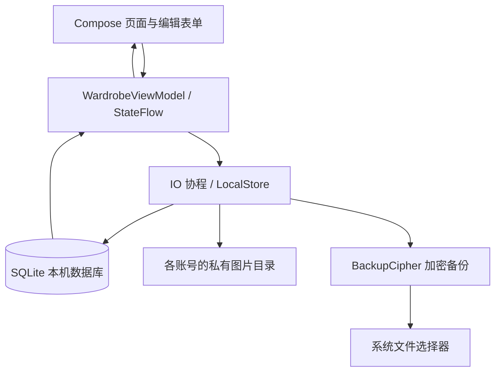

> 当前架构请阅读 [软件架构说明](软件架构说明.md)。本文继续保留为历史基线资料，其中类所在位置与数据库版本不代表当前实现。

> 基线资料（v1.1）：本文保留原版说明，部分页面与流程已在轻量版重构。当前功能和运行方式请看 [轻量版 README](../README.md) 与 [轻量版验证记录](轻量版验证记录.md)。

# 开发说明

## 技术结构

- Kotlin + Jetpack Compose + Material 3；一个 Activity，使用状态驱动的页面切换。
- `WardrobeViewModel` 提供 `StateFlow<AppState>`；UI 使用生命周期感知的收集方式。
- 数据读写、图片解码/导入、密码派生和备份放在 IO 协程；提交时显示进度并拦截重复提交。保存成功后返回，失败时保留表单并显示原因。
- `LocalStore` 通过 `SQLiteOpenHelper` 持久化业务数据；模式版本为 2，版本 1 到 2 的升级添加衣物款式字段并保留原数据。
- AGP 9.3.3 使用内置 Kotlin；Compose 编译器插件 2.2.10，Compose BOM 2025.08.01，Gradle 9.6.0。应通过工程 Wrapper 构建，避免随意更换版本组合。

## 文件入口

| 文件 | 职责 |
| --- | --- |
| `MainActivity.kt` | 应用入口、ViewModel、忙碌状态、错误与消息反馈 |
| `domain/Models.kt` | 业务模型、类别与款式、输入规则、穿着次数和闲置天数算法 |
| `data/LocalStore.kt` | 数据表、账号、业务操作、事务、图片导入、示例数据、备份迁移 |
| `data/BackupCipher.kt` | 备份文件的口令派生、AES-GCM 加密和认证 |
| `ui/Design.kt` | 配色、面板、按钮、原生图标、衣物插画、首页图层 |
| `ui/App.kt` | 登录、五个主页面、顶层路由和转场 |
| `ui/Editors.kt` | 衣物、搭配、计划、实际穿着的编辑和详情 |
| `ui/Profile.kt` | 个人中心、收纳位置、历史与日期筛选 |
| `ui/Backup.kt` | 系统文件选择器及备份/恢复交互 |

代码包名为 `com.wardrobe.atelier`。这是便于课程使用和继续开发的单应用工程，后续人数或功能增加时可以再按业务拆分文件与模块。

## 数据关系与不变量

`accounts` 保存本机账号；`garments`、`outfits`、`plans`、`wears`、`care_logs`、`locations` 均含 `owner` 字段，读写操作检查当前账号。图片路径同样校验账号归属。密码以随机盐加 PBKDF2-HMAC-SHA256 派生值保存，不保存明文。

搭配保存衣物 ID 列表。计划复制当时的名称与衣物 ID；实际穿着保存自己的日期、衣物 ID 与备注，不依赖后续计划或搭配的修改。删除计划或搭配不会删除实际记录。衣物使用归档代替硬删除，从而保留关联。衣物名称等基础资料更改后，历史界面会显示当前衣物资料，并非完整的历史照片/字段快照。

同一账号、同一计划的实际记录由数据库唯一约束和业务检查共同防止重复。即使撤销原记录，原计划关联仍保留，界面显示“穿着记录已撤销”；如需另行记载，可新建独立实际记录。

洗护与穿着是两个独立状态体系：穿了一次不自动标为待洗；撤销一次穿着也不把洗护状态改回去。仅当洗护状态实际变化时生成日志。归档衣物不在当前洗护队列中，历史仍可查询。

## 图片及备份

- 选择图片后读入不超过 5 MB 的内容，检查真实图片格式，按采样缩小至最长边不超过 1600 像素，并处理 EXIF 方向。
- 图片存为应用私有目录下的 JPEG，透明区域使用白底。列表缩略图异步解码。未上传照片的衣物使用款式和颜色生成的矢量轮廓。
- 备份格式为 `.yixu`：版本标记、随机盐、随机 IV、AES-GCM 认证密文。备份口令至少 8 位，使用 PBKDF2 派生密钥。
- 备份包含当前账号的业务记录和照片，不含登录密码。导入时映射记录 ID、重建关联，在事务内替换当前账号内容；认证失败或导入失败不会提交部分数据库变更。
- 当前备份内容限制为 128 MB，导入文件上限 129 MB。大规模图库的备份使用内存缓冲；更大的图库应后续改为流式归档。

## 五人协作建议

以下用于继续开发时划分修改责任；具体人员对应沿用小组已有安排。

| 角色 | 建议维护范围 | 重点联调 |
| --- | --- | --- |
| A | 本机账号、个人中心、账户测试 | 登录会话、密码修改、账号数据隔离 |
| B | 衣物资料、照片、分类筛选、位置管理 | 图片有效性、归档与关联保留 |
| C | 手动搭配、计划、日历 | 计划快照、选择衣物、实际确认入口 |
| D（你的部分） | 实际穿着、洗护状态、两种历史 | 日期校验、重复确认、撤销统计、历史保留 |
| E | 统计、整体集成、界面一致性与测试 | 统计口径、构建、演示与性能测量 |

D 部分重点看 `saveWear`、`voidWear`、`setCare`、`WearEditor`、`HistoryScreen`、`CareHistory`，以及 `LocalStoreTest` 中关于重复确认、撤销和归档的测试。公共数据模型和数据库变更应先统一接口，避免五人同时修改同一段数据层代码。

## 后续可以补充的工程工作

本次验证覆盖主功能与数据不变量。上架前还需进行真实设备兼容性、性能与无障碍专项测试，配置正式签名并检查发布包。若后续增加云同步，应先设计冲突合并、身份验证和备份迁移策略，再调整本机账号模型。

## 实现时查阅的官方资料

图片 EXIF 方向处理使用 AndroidX 库，版本依据 [AndroidX ExifInterface 发布记录](https://developer.android.com/jetpack/androidx/releases/exifinterface)。本机数据的系统备份/设备迁移排除规则依据 [Android Auto Backup 文档](https://developer.android.com/identity/data/autobackup)配置，用户仍可通过应用内的显式加密备份操作迁移业务数据。

本机 IDE 从安装包元数据确认为 Android Studio Quail 2 / 2026.1.2 Patch 1。根据 [Android Studio 与 AGP 官方兼容表](https://developer.android.com/build/releases/about-agp)，Quail 2 支持至 AGP 9.3；本工程因此固定为 9.3.3。[AGP 9.3 官方说明](https://developer.android.com/build/releases/agp-9-3-0-release-notes)要求 Gradle 至少 9.5.0，工程使用已验证的 9.6.0。
