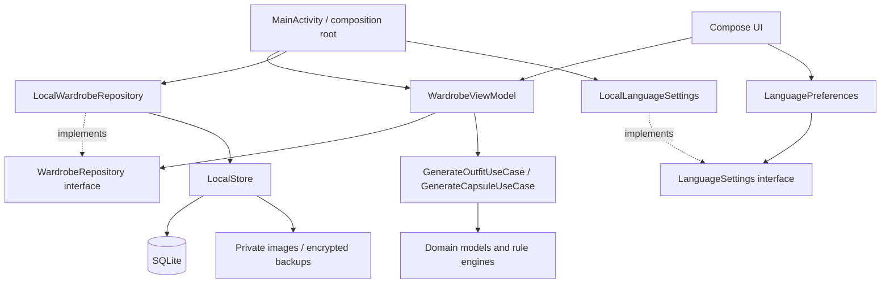
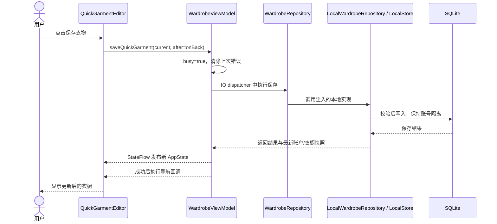

# 衣序轻量版的软件架构

本说明对应当前架构重构版本。架构名称为 **MVVM + 分层架构（Repository 接口与业务用例）**，英文可写作 **MVVM with a layered architecture, repository interfaces and domain use cases**。

## 1. 为什么选择这个架构

软件是本机离线 Android 应用，核心需求包括衣物录入与查找、可控随机搭配、旅行胶囊、可选历史记录、加密备份和中英文切换。Compose 适合依据状态绘制界面，ViewModel 适合在界面重建期间保持操作与状态。数据库和算法则需要能够独立测试。

因此采用 MVVM 组织界面及交互，再将领域规则与存储实现分开。项目保持单一 Gradle 应用模块，以包和接口划分职责，不引入当前没有需求的服务器、微服务或复杂依赖注入框架。

这是一套适合课程项目规模的架构，不声称已经实现全部 Clean Architecture 模式。简单 CRUD 由 ViewModel 调用 Repository 接口；组合与换件等复杂规则通过业务用例执行，避免为每个简单读写增加只转发一次的用例类。

## 2. 各层职责

| 层 | 当前代码 | 应承担的职责 | 不应承担的职责 |
| --- | --- | --- | --- |
| View / UI | `ui/` | Compose 渲染、输入表单、页面导航、动画、临时选择与滚动状态 | 直接调用 SQLite、构造存储实现、提交任意数据库操作代码、直接执行搭配引擎 |
| Presentation / ViewModel | `presentation/WardrobeViewModel.kt`、`AppState.kt` | 提供具名操作、维护只读 StateFlow、协调后台任务、发布成功与失败状态 | 编写 SQL、创建 LocalStore、依赖具体 Compose 页面 |
| Domain | `domain/` | 实体、校验与组合规则、搭配与旅行用例、Repository 和设置接口 | 引用 Android、Compose、SQLite 或外层实现 |
| Data | `data/` | 实现接口，管理 SQLite、文件、账号、事务、备份及语言偏好持久化 | 调用页面、导航或 ViewModel |
| Composition root | `MainActivity.kt` | 创建具体实现并通过 ViewModel Factory 注入，连接 Android 生命周期与系统分享入口 | 承担衣物保存、搭配生成等业务处理 |

`LanguagePreferences` 位于 presentation，保存可观察的语言显示状态；`LocalLanguageSettings` 在 data 层读取 SharedPreferences 和翻译资源。切换语言不会修改业务数据。

## 3. 源代码依赖方向

下面的实线表示代码依赖，虚线表示接口实现。**Data 实现 Domain 定义的接口，Domain 不引用 Data。**



界面直接引用领域实体用于展示是允许的。用户表单、页面选中项和滚动位置属于界面状态，可以保留在 Compose 的 `rememberSaveable` 中；业务快照、加载状态、错误和成功消息由 ViewModel 管理。没有必要把所有光标和动画状态放入 ViewModel。

## 4. 保存一件衣物的实际执行流程



如果保存失败，ViewModel 保留原有数据快照，解除忙碌状态并发布错误；成功回调不会执行，因此编辑页面保留。忙碌期间重复提交会被拦截。取消异常重新抛出，遵循协程取消规则。

## 5. 搭配与旅行用例

- `GenerateOutfitUseCase` 负责组织换整套与换单品请求。换单品时，它固定其余单品、排除待换项，并保持当前搭配结构，再调用纯 Kotlin 的 `InspirationEngine`。
- `GenerateCapsuleUseCase` 调用旅行组合规则。ViewModel 在 Default dispatcher 中执行，页面负责展示结果和滚动动画。
- UI 不直接调用上述规则引擎。引擎和用例不依赖数据库，使用实体列表即可测试。
- 常规衣物、计划、历史和备份操作通过 ViewModel 的显式方法进入 Repository。原来的公开 `vm.perform { 数据库操作 }` 已移除，内部任务协调方法仅供 ViewModel 自身使用。

## 6. 依赖注入与可测试性

`WardrobeViewModel` 的构造参数接收 `WardrobeRepository`，而不是在内部创建 `LocalStore`。MainActivity 的 Factory 注入本地实现；测试注入内存假实现，不打开数据库。

这使得以下情况可以独立验证：

1. 保存成功后先发布新快照，再执行成功回调。
2. 保存失败时保留已有数据、不执行导航回调。
3. 保存尚未结束时，第二次点击不产生重复写入。
4. ViewModel 清除时释放其拥有的 Repository。
5. 单品替换保持其他单品不变，并且不会把待换项再次选中。

SQL 事务、账号隔离、数据库升级和备份恢复仍由既有数据层测试覆盖。界面完整旅程与语言测试负责验证各层连接后仍能工作。

## 7. 如何防止架构边界再次混乱

运行：

```bash
python3 scripts/check-architecture.py
```

检查器禁止 UI 引用数据层、SQLite、公开通用存储执行入口或直接调用规则引擎；禁止 presentation 引用 UI / data 实现；禁止 domain 引入 Android 或外层包；禁止 data 引用 presentation / UI。UI 与 presentation 也不能直接调用 SharedPreferences。

构建脚本和完整回归脚本会自动执行该检查。它是源码依赖守护，不是形式化架构证明，也不能替代代码审查。

## 8. 对现有用户的影响与设计边界

- 保留原数据库 schema、账号、图片目录和备份格式，不清空用户数据。
- 保留本机离线、中英文切换、搭配控制、旅行清单等行为。
- `LocalStore` 作为现有本地数据源保留，其内部仍集中处理多种存储职责。将来团队扩大时可在 data 层内部继续拆分 DAO、图片和备份组件，外层无需因此改变。
- 当前仍是单应用模块，不声称做到了编译模块级隔离或每个页面独立 ViewModel。
- 当前衣橱业务由一个 ViewModel 协调；若后续功能规模明显增长，可按衣橱、搭配、旅行等功能拆分，继续共享 Repository 契约。

## 9. 课堂展示建议

老师要求在实现中使用明确架构，并在最终展示和幻灯片中说明。本项目可使用以下内容制作两页架构介绍，不能只展示目录结构。

**第一页：Architecture — MVVM + Layered Architecture**

放第 3 节架构图，并说明 View、ViewModel、Domain、Data 四部分的职责，以及 Repository 接口如何隔开业务与 SQLite。

**第二页：How it works — Saving a garment**

放第 4 节时序图，沿点击保存、异步执行、存储、状态更新、界面刷新讲解。用假仓库测试截图或测试输出证明层之间可替换、可验证。

可以直接使用的英文讲解：

> Our application uses MVVM with a layered architecture. Jetpack Compose renders the UI and sends user actions to the ViewModel. The ViewModel exposes state through StateFlow and coordinates operations through repository interfaces and domain use cases. The data layer implements these interfaces using local SQLite storage and private files. We inject the repository into the ViewModel, which lets us test success, failure and duplicate submissions without a real database.

对应中文：

> 我们采用 MVVM 与分层架构。Compose 负责显示界面并把用户操作传给 ViewModel；ViewModel 通过 StateFlow 提供状态，并通过 Repository 接口和业务用例协调操作；数据层使用 SQLite 与私有文件实现这些接口。Repository 通过构造参数注入，所以我们可以不使用真实数据库，就测试保存成功、失败和重复提交等情况。
