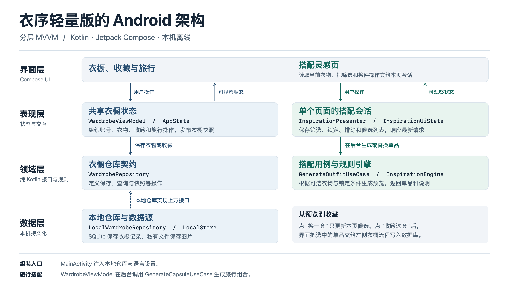
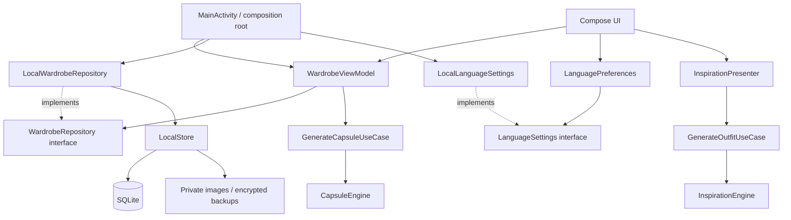
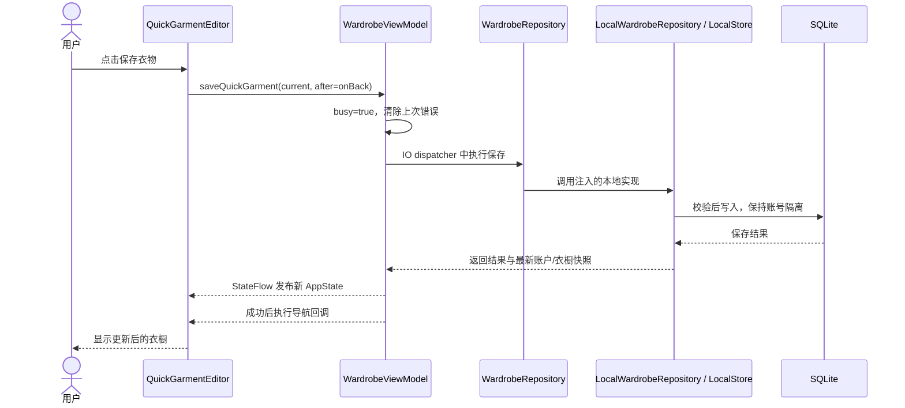

# 衣序轻量版的软件架构

本说明对应架构分支 2.0.0-alpha4。架构名称为 **MVVM + 分层架构（Repository 接口与业务用例）**，英文可写作 **MVVM with a layered architecture, repository interfaces and domain use cases**。

## 1. 为什么选择这个架构

软件是本机离线 Android 应用，核心需求包括衣物录入与查找、可控随机搭配、旅行胶囊、可选历史记录、加密备份和中英文切换。Compose 适合依据状态绘制界面，ViewModel 适合在界面重建期间保持操作与状态。数据库和算法则需要能够独立测试。

因此采用 MVVM 组织界面及交互，再将领域规则与存储实现分开。项目保持单一 Gradle 应用模块，以包和接口划分职责，不引入当前没有需求的服务器、微服务或复杂依赖注入框架。

这是一套适合课程项目规模的架构，不声称已经实现全部 Clean Architecture 模式。简单 CRUD 由 ViewModel 调用 Repository 接口；组合与换件等复杂规则通过业务用例执行，避免为每个简单读写增加只转发一次的用例类。

## 2. 各层职责

| 层 | 当前代码 | 应承担的职责 | 不应承担的职责 |
| --- | --- | --- | --- |
| View / UI | `ui/` | Compose 渲染、输入表单、页面导航、动画、临时选择与滚动状态 | 直接调用 SQLite、构造存储实现、提交任意数据库操作代码、直接执行搭配引擎 |
| Presentation / ViewModel | `presentation/WardrobeViewModel.kt`、`AppState.kt` | 提供具名操作、维护只读 StateFlow、协调后台任务、发布成功与失败状态 | 编写 SQL、创建 LocalStore、依赖具体 Compose 页面 |
| Presentation / 搭配会话 | `presentation/InspirationPresenter.kt` | 维护单个页面的筛选、锁定、排除和候选结果，协调后台计算 | 跨账号共享候选结果、写入衣橱数据库 |
| Domain | `domain/` | 实体、校验与组合规则、搭配与旅行用例、Repository 和设置接口 | 引用 Android、Compose、SQLite 或外层实现 |
| Data | `data/` | 实现接口，管理 SQLite、文件、账号、事务、备份及语言偏好持久化 | 调用页面、导航或 ViewModel |
| Composition root | `MainActivity.kt` | 创建具体实现并通过 ViewModel Factory 注入，连接 Android 生命周期与系统分享入口 | 承担衣物保存、搭配生成等业务处理 |

`LanguagePreferences` 位于 presentation，保存可观察的语言显示状态；`LocalLanguageSettings` 在 data 层读取 SharedPreferences 和翻译资源。切换语言不会修改业务数据。

## 3. 源代码依赖方向

中文图沿两条真实操作绘制。左边展示保存衣物或收藏，右边展示试搭。界面层收集返回的状态后刷新显示。



以下源码依赖图补充旅行与语言设置。实线表示调用方引用的类型，虚线表示接口实现。



界面直接引用领域实体用于展示是允许的。用户表单、页面选中项和滚动位置属于界面状态，可以保留在 Compose 的 `rememberSaveable` 中；业务快照、加载状态、错误和成功消息由 ViewModel 管理。没有必要把所有光标和动画状态放入 ViewModel。

## 4. 保存一件衣物的实际执行流程



如果保存失败，ViewModel 保留原有数据快照，解除忙碌状态并发布错误；成功回调不会执行，因此编辑页面保留。忙碌期间重复提交会被拦截。取消异常重新抛出，遵循协程取消规则。

## 5. 搭配会话与旅行用例

| 操作 | 状态归属与结果 |
| --- | --- |
| 换一套、改筛选条件 | 当前页面的 `InspirationPresenter` 接收操作，在计算线程调用搭配用例，通过 `StateFlow<InspirationUiState>` 发布最新结果。连续改条件时，旧任务的结果会被丢弃。 |
| 切换标签、重建页面 | 每个账号和导航条目有自己的可恢复状态。Compose 保存条件、单品编号、最近 24 个搭配签名和未完成的请求，回到页面后复用结果或继续请求。 |
| 更新衣橱 | 只改位置或备注会保留当前组合。归档锁定的衣物会释放失效的锁定并重新组合。 |
| 收藏这套 | 页面将单品编号交给 `WardrobeViewModel.saveOutfit`，通过仓库写入，并刷新共享衣橱快照。收藏与实际穿着记录各自独立。 |


- `GenerateOutfitUseCase` 负责组织换整套与换单品请求。换单品时，它固定其余单品、排除待换项，并保持当前搭配结构，再调用纯 Kotlin 的 `InspirationEngine`。
- `GenerateCapsuleUseCase` 调用旅行组合规则。ViewModel 在 Default dispatcher 中执行，页面负责展示结果和滚动动画。
- UI 不直接调用上述规则引擎。引擎和用例不依赖数据库，使用实体列表即可测试。
- 常规衣物、计划、历史和备份操作通过 ViewModel 的显式方法进入 Repository。原来的公开 `vm.perform { 数据库操作 }` 已移除，内部任务协调方法仅供 ViewModel 自身使用。

## 6. 依赖注入与可测试性

`WardrobeViewModel` 的构造参数接收 `WardrobeRepository`，而不是在内部创建 `LocalStore`。MainActivity 的 Factory 注入本地实现；测试注入内存假实现，不打开数据库。

这使得以下情况可以独立验证：

1. 保存成功后先发布新快照，再执行成功回调。
2. 保存失败时保留已有数据、不执行导航回调。
3. 保存尚未结束时，第二次点击不产生重复写入。
4. ViewModel 清除时释放其拥有的 Repository。
5. 单品替换保持其他单品不变，并且不会把待换项再次选中。

SQL 事务、账号隔离、数据库升级和备份恢复仍由既有数据层测试覆盖。界面完整旅程与语言测试负责验证各层连接后仍能工作。

## 7. 如何防止架构边界再次混乱

运行：

```bash
python3 scripts/check-architecture.py
```

检查器禁止 UI 引用数据层、SQLite、公开通用存储执行入口或直接调用规则引擎；禁止 presentation 引用 UI / data 实现；禁止 domain 引入 Android 或外层包；禁止 data 引用 presentation / UI。UI 与 presentation 也不能直接调用 SharedPreferences。

构建脚本和完整回归脚本会自动执行该检查。它是源码依赖守护，不是形式化架构证明，也不能替代代码审查。

## 8. 对现有用户的影响与设计边界

- 保留原数据库 schema、账号、图片目录和备份格式，不清空用户数据。
- 保留本机离线、中英文切换、搭配控制、旅行清单等行为。
- `LocalStore` 作为现有本地数据源保留，其内部仍集中处理多种存储职责。将来团队扩大时可在 data 层内部继续拆分 DAO、图片和备份组件，外层无需因此改变。
- 当前仍是单应用模块，不声称做到了编译模块级隔离或每个页面独立 ViewModel。
- 共享衣橱读写由一个 ViewModel 协调。搭配预览已经独立为页面级状态持有者；旅行草稿留在对应页面，生成旅行组合由 ViewModel 调用领域用例。

## 9. 课堂展示建议

老师要求在实现中使用明确架构，并在最终展示和幻灯片中说明。本项目可使用以下内容制作两页架构介绍，不能只展示目录结构。

**第一页：Architecture — MVVM + Layered Architecture**

放第 3 节架构图，并说明 View、ViewModel、Domain、Data 四部分的职责，以及 Repository 接口如何隔开业务与 SQLite。

**第二页：How it works — Saving a garment**

放第 4 节时序图，沿点击保存、异步执行、存储、状态更新、界面刷新讲解。用假仓库测试截图或测试输出证明层之间可替换、可验证。

### 英文讲解

> Our offline wardrobe app uses MVVM with a layered architecture. The wardrobe ViewModel owns the shared inventory. Each outfit screen has its own state holder for filters, locked items and suggestions. Tapping “Shuffle” runs a domain rule on a background thread. Tapping “Save” sends the chosen items to the ViewModel, which writes them through a repository backed by SQLite.

### 中文讲解

> 衣序采用分层 MVVM。衣橱 ViewModel 管理全应用共享的衣物数据，每个搭配页面单独记住自己的筛选条件、锁定单品和推荐结果。点“换一套”时，领域规则在后台算出新的组合。点“收藏这套”时，ViewModel 才通过仓库把单品组合写入 SQLite。
