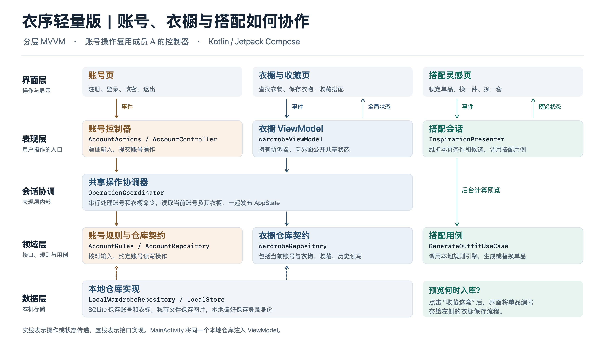

# 衣序轻量版的软件架构

架构分支 2.0.0-alpha5 采用**分层 MVVM**。Compose 订阅状态来绘制界面。账号控制器处理登录、改密与退出，衣橱 ViewModel 提供衣物和收藏操作，搭配页面单独保存本次试搭的条件和结果。

## 两个版本怎样整合

团队在 MVC 工程里为成员 A 完成了账号控制器、验证规则和跨账号测试。融合版将这些实现接入原有分层工程，并让账号与衣物命令共享一个协调器、一份当前账号状态和同一个本地仓库。账号模块的来源见 [main 中成员 A 的 MVC 工程](https://github.com/chenajirui123123/pwwww/blob/c07eb6338a7b46275913585c120d688787253a1a/WardrobeManager_MVC_A_GitHub.zip)。

| 用户操作 | 表现层入口 | 领域规则与数据 | 界面看到的结果 |
| --- | --- | --- | --- |
| 登录、注册、改密、退出 | 账号页面调用 `AccountActions`，由 `AccountController` 实现 | `AccountRules` 验证输入，`AccountRepository` 提供账号操作 | 更新当前账号及其衣橱 |
| 保存衣物、移动位置、收藏搭配 | `WardrobeViewModel` 的具名方法 | `WardrobeRepository` 定义写入与查询，数据层负责本机持久化 | 发布更新后的共享衣橱 |
| 筛选搭配、锁定或替换单品 | 单个页面的 `InspirationPresenter` | `GenerateOutfitUseCase` 调用本地组合规则 | 更新本页预览，最近 24 个组合签名用于识别重复 |
| 生成旅行组合 | `WardrobeViewModel` | `GenerateCapsuleUseCase` 在后台计算 | 页面展示草稿，用户选择保存后才写入 |
| 选择中文或英文 | `LanguagePreferences` | `LanguageSettings` 由本地设置实现 | 切换界面文案，保留用户输入的内容 |

## 账号与衣橱怎样保持一致

`MainActivity` 注入一个 `LocalWardrobeRepository`。它通过同一个 `LocalStore` 实例访问 SQLite、私有图片以及当前本机身份。`WardrobeRepository` 继承账号契约，账号控制器只接收较窄的 `AccountRepository` 接口。ViewModel 持有 `OperationCoordinator`，并将它的 `StateFlow<AppState>` 提供给 Compose。

1. 用户发出账号或衣橱命令后，协调器先取得执行权。如果已有命令正在处理，重复点击或同时到来的另一个写操作会被拦下。
2. 后台执行命令一次，然后读取当前账号及其衣橱。协调器将两者合在一份状态中发布，随后执行成功回调。
3. 写操作报错时，协调器重新从数据源确认当前身份并显示错误。这样即使底层已经切换账号，界面也不会把上一位用户的衣橱当作当前数据。
4. 首次读取状态失败时，协调器再读一次。两次读取都失败后，界面收起衣橱，显示“重新读取衣橱”。此时只接受读取操作。用户点击重试会读取当前状态，之前的收藏、保存或改密命令只执行一次。

账号表、衣橱表和备份格式沿用已有实现。登录和退出先确认本机身份偏好保存成功，再更新存储实例里的当前用户编号。密码及其确认输入仅保存在当前界面内存中，Activity 重建后需要重新输入。

## 课堂演示可以走两条流程

**换一套，再收藏。** 先锁定一件单品并点击“换一套”。搭配会话在后台算出候选，界面订阅 `InspirationUiState` 展示结果。接着点击“收藏这套”，界面把选中的编号交给 `WardrobeViewModel.saveOutfit`，协调器安排仓库写入并刷新衣橱。试搭与收藏都不会自动创建实际穿着记录。

**从 A 的衣橱切到 B。** 用 A 账号保存一件衣物，退出后登录 B，再回到 A。B 看到自己的衣橱，回到 A 后先前的衣物仍在。模拟器测试覆盖这条真实页面旅程，单元测试通过注入读取故障覆盖难以现场重现的异常情况。

### 英文讲解

> Our offline wardrobe app uses layered MVVM. Compose observes the current account and wardrobe together. An account controller validates sign-in and profile actions. It shares one operation coordinator with the wardrobe ViewModel, so switching accounts and saving clothes cannot overlap. Outfit previews have their own screen state. A suggestion enters the database when the user saves it.

## 代码入口与验证

- [账号操作和控制器](../app/src/main/java/com/wardrobe/atelier/presentation/AccountController.kt)
- [共享操作协调器](../app/src/main/java/com/wardrobe/atelier/presentation/OperationCoordinator.kt)
- [衣橱 ViewModel](../app/src/main/java/com/wardrobe/atelier/presentation/WardrobeViewModel.kt)
- [搭配会话](../app/src/main/java/com/wardrobe/atelier/presentation/InspirationPresenter.kt)
- [架构回归结果和复现方法](架构重构验证记录.md)

本项目保留一个 Gradle 应用模块，以 Kotlin 包和接口划分职责。构建时运行 `scripts/check-architecture.py` 检查包依赖，JVM 与模拟器测试验证实际行为。
